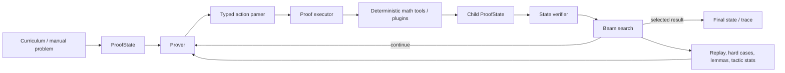

# Math Sentinel

Math Sentinel is an experimental stateful neural/symbolic proof-search system for synthetic mathematics. Its central object is an explicit `ProofState`: the prover proposes typed actions against that state, deterministic tools execute supported mathematical operations, a verifier scores candidate states, and search keeps the strongest branches.

Math Sentinel is research software. It is **not** Lean, Coq, or a formal theorem prover, and it does not provide kernel-checked proofs.

## Capabilities

The current implementation includes:

- a compact causal transformer **prover**;
- a recurrent **state verifier**;
- explicit proof-state serialization and state transitions;
- typed proof actions such as `THINK`, `APPLY`, `CHECK`, `ANSWER`, `REWRITE`, `LEMMA`, `SUBGOAL`, `RESOLVE_SUBGOAL`, `ASSUME`, `BACKTRACK`, `CALL_PLUGIN`, and `SIMPLIFY`;
- deterministic tools for arithmetic, fractions, algebra, calculus, number theory, and basic logic;
- verifier-guided beam search with fallback repair actions;
- replay memory, hard-case tracking, lemma storage, and tactic statistics;
- procedural curriculum generation; and
- checkpointed training, evaluation, and interactive sampling/solving entry points.

The built-in curriculum currently covers arithmetic, fractions, divmod, gcd/lcm, modular arithmetic, primality, factorization, linear equations, polynomial simplification, derivatives, antiderivatives, and short parity-proof templates.

## Architecture



A typical solve path is:

1. A curriculum generator or manual input creates a task.
2. The task becomes a structured `ProofState`.
3. The prover proposes action traces conditioned on the serialized state.
4. The parser converts valid traces into typed actions.
5. The executor applies those actions using exact tools where supported.
6. The verifier scores resulting states.
7. Beam search retains the strongest branches until it reaches a terminal state or the search budget ends.
8. Training-time memory stores retain useful solved, failed, and mined examples.

## Repository layout

```text
math-sentinel/
├── README.md
├── CHANGELOG.md
├── requirements.txt
├── requirements-dev.txt
├── train.py
├── eval.py
├── sample.py
├── config/
├── curriculum/
├── memory/
├── plugins/
├── proof/
├── search/
├── sentinel/
├── tools/
├── tests/
└── docs/
```

## Installation

Python 3.12 is used by CI.

```bash
python -m venv .venv
source .venv/bin/activate
python -m pip install --upgrade pip
python -m pip install -r requirements.txt
```

On Windows PowerShell:

```powershell
python -m venv .venv
.\.venv\Scripts\Activate.ps1
python -m pip install --upgrade pip
python -m pip install -r requirements.txt
```

For development and tests:

```bash
python -m pip install -r requirements-dev.txt
```

Operational details are documented in [runbook.md](runbook.md).

## Training

Short CPU/GPU smoke run:

```bash
python train.py --steps 20 --batch-size 4 --micro-batch-size 4 --eval-every 10 --save-every 10
```

Longer CUDA run:

```bash
python train.py --steps 2000 --batch-size 16 --micro-batch-size 8 --device cuda --compile
```

Resume from the latest checkpoint:

```bash
python train.py --resume checkpoints/last.pt
```

The default training log is `logs/train.jsonl` and the default checkpoint is `checkpoints/last.pt`.

## Evaluation

Evaluate a checkpoint:

```bash
python eval.py --checkpoint checkpoints/last.pt --count 64
```

Evaluation reports the selected curriculum phase, solved rate, answer-equivalence rate, and average explored branches. These metrics are research diagnostics, not formal proof guarantees.

## Solving and sampling

Sample a generated task:

```bash
python sample.py --checkpoint checkpoints/last.pt
```

Run a manual problem:

```bash
python sample.py --checkpoint checkpoints/last.pt --domain linear_equation --problem "Solve: 2x + 3 = 11"
```

The command prints the input task, final serialized proof state, human-readable trace, and explored-node count.

## Plugins

A checker/tool plugin can register additional deterministic tools with `ToolRegistry`.

```bash
python train.py --checker-plugin plugins/example_checker_plugin.py
python sample.py --checker-plugin plugins/example_checker_plugin.py
```

The example plugin demonstrates the registration contract; it is not a general-purpose proof backend.

## Search

`config/default.yaml` defines the base runtime search configuration. When present, `config/search.yaml` overrides search parameters such as beam width, maximum depth, proposal count, temperature, top-k sampling, and scoring weights.

`search/mcts.py` is currently an experimental compatibility surface that reuses beam search; Math Sentinel does not currently implement a full Monte Carlo tree-search engine.

## Replay and memory

Persistent training memory includes:

- a replay buffer for solved, failed, and mined examples;
- a hard-case store;
- a lemma store; and
- tactic success statistics.

Paths and capacities are configured under `memory` in `config/default.yaml`.

## Curriculum

The curriculum scheduler selects groups of supported domains as training advances. Its phase terminology describes runtime curriculum progression; it is not a repository release/version scheme.

## Testing and verification

Run the full test suite with:

```bash
python -m pytest -q
```

A lightweight end-to-end configuration is available for CLI smoke testing:

```bash
python train.py --config config/smoke.yaml --steps 1 --batch-size 1 --micro-batch-size 1 --eval-every 100 --save-every 100 --memory-refresh-samples 0 --device cpu
python eval.py --config config/smoke.yaml --count 1 --step 1
python sample.py --config config/smoke.yaml --domain arithmetic --problem "What is 2 + 2?"
```

GitHub Actions runs the unit tests, bytecode compilation check, CLI import/help checks, and these smoke workflows on pull requests and pushes to `main`.

## Limitations

Math Sentinel remains deliberately narrow:

- it is not a formal theorem prover and has no trusted proof kernel;
- proof states are explicit but lightweight;
- the prover and verifier are small research models;
- verifier supervision is synthetic;
- search depth is bounded;
- theorem discovery is not the current target;
- grammar-constrained decoding is not implemented; and
- the MCTS module does not yet provide a distinct MCTS algorithm.

Use outputs as research artifacts that still require independent mathematical validation where correctness matters.
